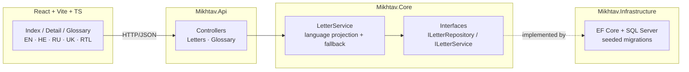

# Mikhtav · Israeli Letters Explained

> _Mikhtav_ (מכתב, "letter" in Hebrew) is a small bilingual web app that helps olim — and
> anyone struggling with Hebrew bureaucratic mail — understand the official letters that arrive
> from Israeli authorities. Pick a letter type, get a section-by-section explanation in
> **English, Hebrew, Russian, or Ukrainian**, along with what action is required and the
> deadline.

**Educational information only.** Mikhtav preserves public official originals, imports no personal records, and is not
legal advice. Verify your specific letter with the issuing authority.

**Stack:** ASP.NET Core Web API (.NET 8) · Entity Framework Core · SQL Server · React +
TypeScript (Vite) · react-i18next with full RTL · xUnit · Vitest · GitHub Actions.

---

## Architecture

A layered backend behind a thin API, with per-language content stored in the database. The
frontend picks one language per request; missing translations fall back to English so
something always renders.



**Projects**

| Project | Responsibility |
|---|---|
| `Mikhtav.Core` | Domain models, DTOs, service interfaces, `LetterService` (the language-projection logic). No framework dependencies. |
| `Mikhtav.Infrastructure` | EF Core `DbContext`, seeded migrations, the repository implementation. |
| `Mikhtav.Api` | Controllers, DI wiring, Swagger, CORS. |
| `Mikhtav.Tests` | xUnit tests for `LetterService` (Hebrew labels, language fallback, ordering). |
| `src/web` | React + TypeScript frontend, four-language UI, full RTL. |

---

## Public product workflow

### Imported official originals

`/documents` is a separate library of public official forms, PDF guides and information
pages. It does not relabel blank application forms as incoming personal notices. Each entry
has an original Hebrew title, four-language editorial metadata, official URLs and related
letter guides. `?letter=<slug>` filters the library to a specific explanation.

The curated registry is `data/official/manifest.json`. Run
`node tools/official/import.mjs` from the repository root to fetch the registered public
URLs. The current adapter uses direct HTTPS HTML/PDF downloads; no public outgoing-letter
API was confirmed. There is no sign-in, private-account scraping or automatic form submission.
The site reads the published JSON endpoint `/official/documents.json` rather than making
cross-origin requests to authorities from each visitor's browser.

The importer validates every redirect against exact public official hosts, limits streamed
response sizes/timeouts, rejects HTML challenges disguised as PDFs, and stores unchanged
response bytes with SHA-256. It archives HTML under `data/official/snapshots` only; HTML is
never served as executable content. PDFs are also copied unchanged under
`src/web/public/official/files`. HTTP errors are published as unavailable, with no pretend
cached-original link. Earlier successful archives remain available for review. Each run
records new/unchanged/changed/unavailable results and does not alter editorial review dates
or guidance automatically. Raw HTML changes can be navigation or dynamic-token changes.

On 2026-10-29, seven of eight resources were retrieved (five PDFs and two HTML pages);
the biometric-ID information page returned HTTP 403. A retrieval timestamp is not a legal,
professional translation or editorial approval. The first pages of all five PDFs were
visually inspected; originals are not edited or filled by this application.

Offline validation: `node tools/official/verify.mjs`. Transport regression tests:
`node --test tools/official/transport.test.mjs`. CI runs both alongside the frontend tests.
Reimport is an explicit command, not a recurring background service.

The public catalog includes a three-step letter finder (sender, original Hebrew heading,
possible guides), a per-letter checklist and an official-source panel. The finder compares
catalog headings; it does not authenticate notices or determine personal obligations.
No personal documents are uploaded. Checklist progress lives in browser storage, keyed by
letter slug and editorial version, and is invalidated when the action content changes.
Printing produces a concise task list. Storage denial falls back to in-memory progress.

### Editorial architecture

`src/Mikhtav.Core/Content/translations.json` stores normalized language records separately
from structural letter identities in SeedData. `EditorialCatalog` applies these records to
the existing LetterService DTOs in both API responses and generated snapshots. Intentional
null actions/deadlines suppress outdated seed text. This avoids adding database columns per
language and creates a seam for a later editorial CMS. It is currently a versioned file
catalog, not a database-backed admin system.

`provenance.json` records each letter's version, official sources, source coverage and the date
the links/content were checked. This date is not an independent legal or professional
translation review. Some GOV pages blocked direct retrieval; provenance scopes document
where official indexed content was used. Explanations are educational, and the reader must
check their own notice for dates, amounts and applicable instructions.

After changing content, run the exporter and `node tools/verify-catalog.mjs` from the repository
root. The validator checks all four locale snapshots, section identity, completeness, index/detail
parity and official-source metadata. Bump a letter's editorial version when its actions change.
Frontend features live under `src/web/src/features/`; each owns behavior, styles and tests.

Project skills are in `.agents/skills/mikhtav-content` and `.agents/skills/mikhtav-release`;
reusable editor and UI-reviewer agent definitions are in `.cursor/agents/`.
The next stage is an authenticated editor with drafts/review/publish, a persistent translation
repository and server hosting; those services are not provisioned by this public release.

## Running it

### Vercel / standalone catalog

The frontend runs without a database or API by default. It reads versioned JSON snapshots
of the existing editorial seed data from `src/web/public/catalog/` (7 letters and the glossary,
in EN/HE/RU/UK, using the same translation fallbacks as the API). These are curated examples,
not live authority data. Missing translations still fall back to English.

Import the repository into Vercel with root directory `src/web` and framework Vite;
`src/web/vercel.json` supports direct links to letter and glossary pages.
Set `VITE_API_URL` at build time to use a separately hosted .NET API instead.

After editing seed content, regenerate snapshots from the repository root with .NET 10:

```bash
dotnet run --project tools/ExportCatalog -- src/web/public/catalog
```

The exporter uses the actual `LetterService`, so guidance, severity and language fallback
stay consistent with the backend. Generated JSON is committed; Vercel needs only Node.
The catalog includes multilingual search and an action-required filter; the glossary supports
Hebrew, transliteration and meaning search.

Requires the .NET 8 SDK (or newer), SQL Server LocalDB (default), and Node 20+.

```bash
# 1. Backend
dotnet tool restore
dotnet run --project src/Mikhtav.Api
# → http://localhost:5080/swagger

# 2. Frontend
cd src/web
npm install
npm run dev
# → http://localhost:5173
```

In Development the DB is created from the EF migration and seeded automatically on startup.

### Migrations

EF Core migrations are checked in under `src/Mikhtav.Infrastructure/Migrations/`. `dotnet-ef`
is a local tool — restored once with `dotnet tool restore`. New migrations:

```bash
dotnet ef migrations add <Name> \
  --project src/Mikhtav.Infrastructure \
  --startup-project src/Mikhtav.Api
```

### Tests

```bash
dotnet test                       # xUnit, language-projection logic
cd src/web && npm run test:run    # Vitest, RTL flip behaviour
```

---

## Content model

A letter type belongs to a **category** (issuing authority) and has an ordered list of
**sections**. Each section is what appears as a heading on the actual letter — stored in
Hebrew exactly as printed — plus a per-language explainer, an optional action, an optional
deadline, and a **severity** (`info` / `warning` / `critical`) that drives visual emphasis.

A separate **glossary** indexes recurring bureaucratic Hebrew terms with their transliteration
and per-language meaning.

```
LetterCategory (1) ──< LetterType (1) ──< LetterSection
BureauTerm     (independent)
```

All language columns except `*En` are nullable; the API's `LetterService` falls back to
English when the requested language is missing, so the UI never renders empty strings.

---

## Design decisions

These are the choices I'd defend in a review — no metrics I can't measure, just the reasoning.

- **Layered with interface seams.** `Core` holds the business logic and depends on nothing.
  The repository sits behind `ILetterRepository`, so `LetterService` is testable without a
  database — see `Mikhtav.Tests/LetterServiceTests.cs`.
- **Language projection at the service layer, not the database.** Storing one row per language
  would balloon the schema; storing parallel columns keeps the seed file readable and the
  fallback logic in one tiny `switch` (`LetterService.PickName` and friends).
- **HE label as the section's primary identity.** Each section's heading is stored verbatim in
  Hebrew (`LabelHe`) — that's what's printed on the user's letter. The translation never
  replaces it, only annotates it.
- **Severity drives both copy and colour.** Three buckets only: informational (blueprint blue),
  pay-attention (mustard), critical (vermillion). Same vocabulary across HE/EN/RU/UK.
- **Curated content, not OCR.** v1 doesn't try to read photos of letters. We curate the
  category, build out one type at a time, and own the editorial quality of every explainer.

---

## Roadmap

- [x] Skeleton — layered API, EF Core + migrations, React + Vite + TS + i18n + react-router
- [x] First two letter types — Bituach Leumi enrolment confirmation, Mas Hachnasa annual demand
- [x] Glossary — 15 common bureaucratic Hebrew terms with EN/RU translations
- [x] Editorial-archive design system with full RTL
- [x] Vitest + xUnit tests; CI on every push
- [ ] Ukrainian translations for the seeded content
- [ ] More letter types: Misrad HaPnim (teudat zehut renewal), Misrad HaBriut (TIPAT HALAV),
      Bituach Leumi (maternity benefit), Education ministry (school enrolment)
- [ ] Search across letter titles, section labels, and glossary
- [ ] Arabic locale
- [ ] Letter-type submission form so olim can request new explainers
- [ ] Deploy to Azure (App Service + Azure SQL + Static Web Apps)

---

## Notes & disclaimer

- This is **educational content** about common categories of letters. It is **not legal,
  financial, or immigration advice**. Verify your specific letter with the issuing authority
  (Bituach Leumi, Mas Hachnasa, Misrad HaPnim, etc.).
- No personal data is collected. The catalog is read-only in v1.
- Built with care for olim who are tired of guessing what their mail says. Tovah aliyah —
  may yours be smoother because of small tools like this.
